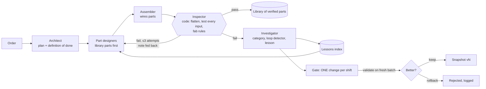

# AutoFab

**We built the factory, not the chips.** A team of NVIDIA Nemotron agents on Crusoe Managed Inference designs small logic chips from a plain-English order, verifies every one on every possible input, learns from its own failures, and proves the improvement on the same 40-chip exam it has never seen.

Recursive Agents Hackathon · San Francisco · Oct 17, 2026 · Track: **Version N+1** (also demonstrates *Done Means Done* and *Shared Brain*).

<!-- TODO(video): link to the 1-minute video once it is uploaded -->
**Video:** _TBD_ · **Live stage:** `uvicorn server:app --port 8000` → http://localhost:8000/

---

## The idea

Most agent demos show a model doing a task. AutoFab shows a *team that gets better at the job*, and shows the receipts.

- The product is a chip fab. You type an order ("a calculator that adds two numbers", "a door lock that opens only for codes 3, 9, 13, 14"). A team of agents plans it, designs the parts, wires them together, and an **independent inspector made of code** (not a model) tests every possible input and checks hidden fab rules.
- Between shifts the factory changes **itself**, one change at a time, from a fixed menu. A change is kept only if it wins on a fresh validation batch; otherwise it is rolled back.
- Every version of the factory sits the **same 40-chip exam** that was frozen before any learning started and is never used for learning.

## The loop



## Results

> The numbers below are produced by `python tools/report.py` from `runs/run.json` (real Crusoe calls). Nothing here is typed by hand.

### Ablation on the frozen 40-chip exam

<!-- REPORT:EXAM — paste the "Exam" table from `python tools/report.py` -->
_Pending the long run._

Reading guide: bare = one cheap model with no schema, no lessons, no library · v1 = the starting team · vN = the team after N−1 kept changes. Exam pass means: correct on all inputs **and** every fab rule ok **and** within 3 capped attempts.

### Changes the factory tried (kept and rejected)

<!-- REPORT:SHIFTS — paste the "Shift log" table from `python tools/report.py` -->
_Pending the long run._

### What the agents wrote for themselves

<!-- REPORT:LESSONS — paste the "What the team wrote for itself" list from `python tools/report.py` -->
_Pending the long run._

### Receipts

<!-- REPORT:RECEIPTS — paste the "Receipts" line from `python tools/report.py` -->
_Pending the long run._

## The team (all NVIDIA Nemotron on Crusoe)

| Role | Model | Notes |
|---|---|---|
| Architect | Nemotron 3 Super 120B | plan, definition of done, spawns one designer per part |
| Part designer | Nemotron 3.5 Lightning 30B | reads lessons and verified parts first; novel functions can be routed to Super |
| Assembler | Nemotron 3.5 Lightning 30B | wires parts; every port must be connected |
| Inspector | **code** | flattens the blueprint, tests all 2ⁿ inputs, checks fab rules; never trusts a self-report |
| Inspector-with-eyes | Nemotron 3.5 Super VL | optional: looks at the drawn failed circuit and names the wrong wire |
| Investigator | Nemotron 3.5 Lightning 30B | failure categories, loop detection, lessons in the fault's own words |
| Gate | Nemotron 3 Super 120B | proposes one change per shift |

`team.json` holds the same roster in the NemoClaw agents-manifest shape.

**Failure categories:** `format` · `wrong_logic` · `assembly` · `rules` · `budget` · `spiral` (the model thinks forever without answering).

**The Gate's menu** (fixed; the Gate chooses and validation decides): `schema_on` · `no_fast_lane` · `route_novel_to_super` · `loop_cutter` · `tidy_tool` · `fanout_buffer_rule` · `library_first` · `stable_prefix`, plus routing experiments it is allowed to try and expected to see rejected.

## Why this is a fair test

- **Frozen exam.** 40 orders from a seeded generator; the seed is committed in `orders/exam_seed.json` (commit `212665e`, 10:43 on Oct 17, before the long run started). Practice and validation pools come from the same generator with different seeds. The exam is read-only.
- **The inspector is code.** Exhaustive truth-table check on every input, plus hidden fab rules (fan-out, depth, unused gates, pin wiring, gate budget, allowed gates). A model never grades a model.
- **Baseline you can check.** Each order carries `best_known_gates` from Yosys/ABC, so "gates vs best known" is a real number.
- **One change per shift**, kept only if gain beats noise *and* cost is justified *and* no rung regresses. Rejected changes stay on screen.
- **Every number on the stage is read from `runs/run.json`**; the page computes nothing.

## The stage

`web/index.html` (three.js, no build step) replays the real event log of any chip: blocks drop in, traces draw themselves, a pulse runs through the circuit, the inspector's plain-English note appears, the wrong wire turns red, the team repairs it, the lesson card lands. Version shelf, chip picker, **Race** (two versions on the same order side by side), **Lights** (lights-out view), and live gauges (tok/s, TTFT, cache hit, $ per chip). A live order (`POST /order`, a menu pick or a fresh unseen rung) is run by `python -m engine.runner --live` and replayed on the stage as it finishes.

## Run it

```bash
pip install -r requirements.txt
export CRUSOE_API_KEY=...                 # or put the key in ~/.crusoe_key (never committed)

python -m engine.runner --shifts 8 --exam v1,v4,v8   # the long run: writes runs/run.json and snapshots/
python -m engine.runner --live                       # serve live orders from the stage
uvicorn server:app --port 8000                       # the stage at http://localhost:8000/
python tools/report.py                               # prints the tables for this README
bash scripts/test.sh                                 # the test gate
```

No key? `python -m http.server 8765` from the repo root and open `/web/` to replay `samples/run.sample.json`.

## Built on Crusoe

Managed Inference for every call (model ids from `/v1/models`) · structured outputs (`response_format` JSON schema = the first kept change in our runs) · thinking controls · a client-side loop-cutter (the proxy rejects `reasoning_budget`) · per-model rate limits handled with a semaphore per model · `cached_tokens` for the cache gauge · usage × price = real $ per chip.

<!-- TODO(night shift): if run — fine-tune job id, loss, and whether the tuned model was served; otherwise delete this line -->
**Night shift (optional):** _TBD_

Full plan and measured API facts: [`docs/PLAN.md`](docs/PLAN.md). Data contracts: [`docs/CONTRACTS.md`](docs/CONTRACTS.md). Status board: [`TASKS.md`](TASKS.md).

## Honesty notes

- The exhaustive-test checker and the API harness (`tools/spike_checker.py`) were built the night before as a feasibility spike; everything else was built on Oct 17.
- Fab rules (fan-out, depth, budgets) are simplified versions of real design rules.
- Judged numbers come only from Crusoe calls. Other providers, if used, were for pipeline smoke tests only.
- AI coding assistants wrote much of the code under human direction; commits carry co-author lines.

## Team

<!-- TODO(team): names and GitHub handles of everyone submitting -->
_TBD_

## License

See [`LICENSE`](LICENSE).
